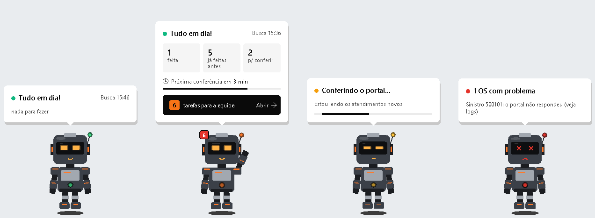
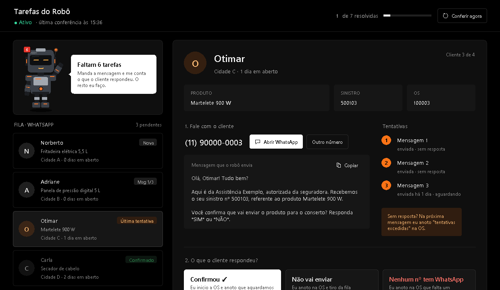
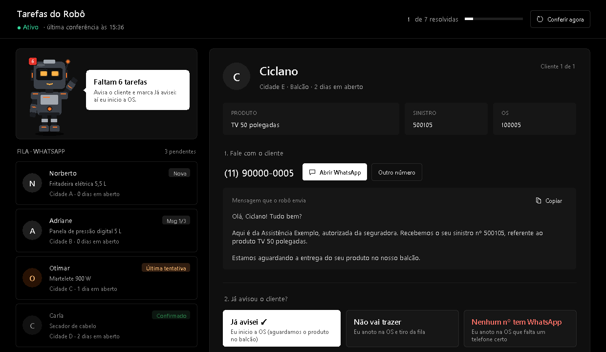
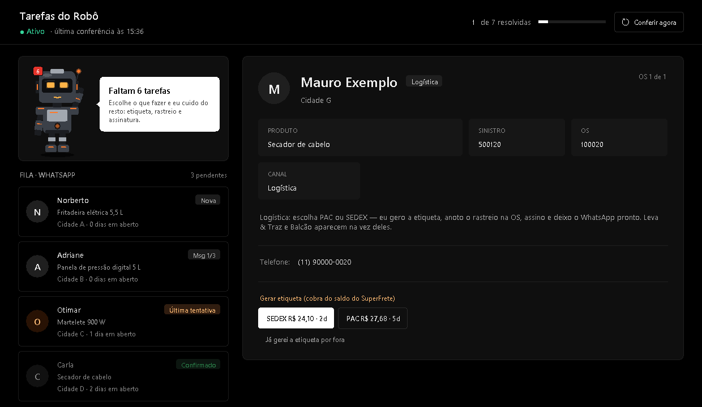
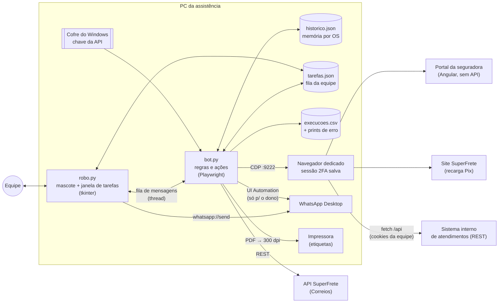
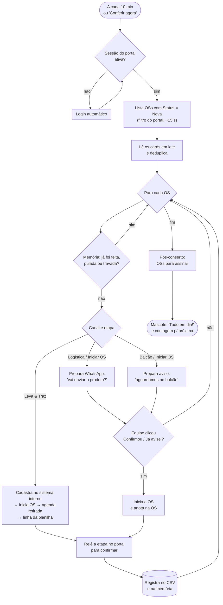
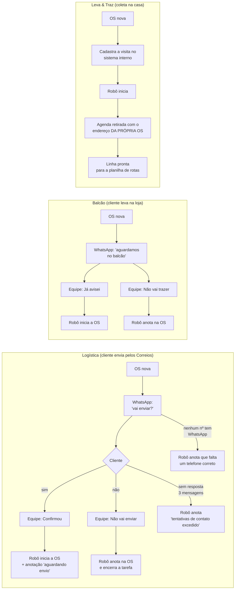
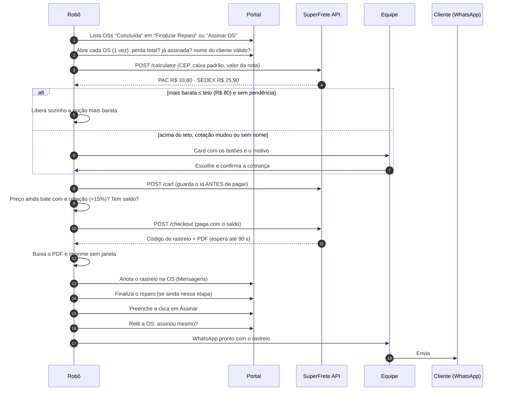
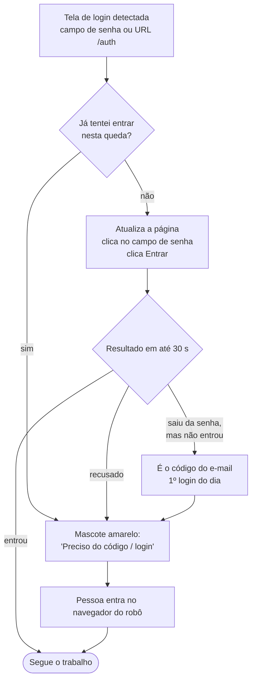
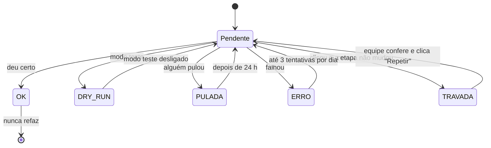

# Robô Prestador — automação do portal de uma seguradora

> Robô em Python que opera, sozinho e com segurança, o portal web de prestadores de uma
> seguradora de garantia estendida. Ele cuida da parte mecânica do dia a dia de uma
> assistência técnica e deixa para a equipe só as decisões.



> Nomes da seguradora e da assistência, números de OS e dados de clientes foram
> **anonimizados**. Os prints usam dados inventados.

---

## O problema

Uma assistência técnica autorizada recebe todas as ordens de serviço (OS) por um **portal
web da seguradora**: uma aplicação Angular **sem API pública** e com **login em dois
fatores**. Cada OS passa por várias etapas, como iniciar, agendar coleta, receber, consertar,
devolver ao cliente e assinar. Em cada uma a equipe:

- abria a OS no portal, preenchia data e responsável e clicava em salvar;
- copiava nome, telefone e endereço do cliente para a planilha e para o WhatsApp;
- gerava a etiqueta dos Correios em outro site e copiava o rastreio de volta para a OS.

Esse trabalho é repetitivo, sujeito a erro de cópia e toma horas por dia.

## A solução

Um robô de desktop que:

1. **Lê o portal** a cada 10 minutos: filtra as OSs novas e as que estão para assinar.
2. **Faz as etapas mecânicas sozinho**: iniciar OS, agendar retirada, anotar mensagens e
   assinar.
3. **Prepara o que depende de gente** numa janela de tarefas: o WhatsApp para o cliente já
   escrito, a linha pronta para a planilha e a etiqueta já cotada.
4. **Executa depois de um clique**: o cliente confirmou → inicia a OS e anota na OS.
5. **Fecha o pós-conserto sem clique nenhum**: escolhe a etiqueta mais barata, paga, imprime
   na impressora da loja, anota o rastreio, finaliza o reparo, assina a OS e deixa o
   WhatsApp com o rastreio pronto.
6. **Cuida do próprio saldo**: quando o crédito dos Correios fica baixo, gera um Pix de
   recarga no site do intermediador e manda para o dono por WhatsApp.
7. **Alimenta o sistema interno da empresa**: as coletas (Leva & Traz) entram sozinhas no
   sistema de atendimentos de campo, pela API dele.
8. **Mostra o que está fazendo** com um mascote animado no canto da tela: luzes verdes quando
   está tudo em dia, **acenando** em laranja quando há tarefa para a equipe, âmbar conferindo
   o portal ou precisando de alguém, vermelho com problema.



| Balcão | Depois do conserto (etiqueta) |
|---|---|
|  |  |

### A interface (redesign de 24/11)

O visual nasceu de um canvas de design (robô, balão e janela) e foi reproduzido no `Canvas`
do tkinter, sem bibliotecas de interface:

- **Mascote:** robô de armadura grafite com olhos de LED. O humor segue o estado do robô:
  feliz, concentrado (olhos apertados) ou **acenando** quando há tarefa. O braço é um
  polígono girado a cada quadro; o SVG tem gradientes e brilho, que viram cores misturadas.
- **Balão:** a hora da última busca, o resumo do ciclo em números ("1 feita · 5 já feitas
  antes"), a contagem para a próxima conferência com barra e o botão "N tarefas para a
  equipe · Abrir".
- **Janela em modo foco:** à esquerda a fila de tudo que espera a equipe, por grupo; à
  direita só o cliente escolhido, em dois passos: **1. Fale com o cliente** (telefone,
  abrir o WhatsApp, outro número, mensagem pronta para copiar e as tentativas já feitas) e
  **2. O que o cliente respondeu?** (botões grandes). Marcou a resposta, abre o próximo.
- Tudo é copiável: um clique copia sinistro, OS, produto ou telefone; o botão direito abre
  "Copiar tudo".

---

## Arquitetura



- **Por que conectar via CDP num navegador aberto?** O portal exige 2FA. A pessoa faz o login
  uma vez no navegador do robô e a sessão fica salva no perfil dedicado. O robô só se
  conecta a ele, sem guardar senha nem contornar o 2FA.
- **Interface e robô em threads separadas**, conversando por uma fila: o mascote nunca
  trava enquanto o navegador trabalha. O mesmo bot roda em modo terminal (`--uma-vez`,
  `--debug`).
- **Um único `.exe`** (PyInstaller): a equipe dá clique duplo e pronto. Configuração, memória e
  logs ficam ao lado do executável.

---

## O ciclo do robô



### Entrada da OS por canal



---

## Depois do conserto: etiqueta, rastreio e assinatura



- **Etiqueta automática:** a opção mais barata é liberada sem clique até um teto
  configurável. Acima do teto, com cotação alterada, cliente sem nome válido ("Não
  Informado", uma palavra só) ou tarefa que a equipe desfez, o robô para e pede a pessoa.
- **Pagamento idempotente:** o id do envio é salvo antes do checkout. Se o robô cair no meio,
  continua do mesmo envio e nunca paga duas vezes. Rastreio que demora vira "aguardando",
  não erro.
- **Impressão sem janela:** o leitor de PDF padrão do Windows não imprime sem clique, e
  imprimir o PDF direto saía com códigos de barras em branco nesta impressora. O robô
  desenha a página em 300 dpi com `Windows.Data.Pdf` e manda a imagem pelo
  `System.Drawing.Printing`, num script PowerShell, sem instalar nada.

### Recarga do saldo dos Correios

A API do intermediador lê o saldo mas não faz recarga. Quando o saldo fica abaixo do mínimo,
ou uma etiqueta para por falta de crédito, o robô:

1. abre o site do intermediador na aba já logada e gera um **Pix de R$ 400** (confere o
   valor pelo texto do botão, porque o estado do `input` não acompanha a tela);
2. copia o código pela área de transferência (limpa antes e devolve o conteúdo anterior);
3. manda a mensagem com o Pix **para o WhatsApp do dono**, e só para ele. Antes do Enter,
   um script de **UI Automation** confere que o contato certo está aberto, que o texto
   está na caixa e que não apareceu "não está no WhatsApp";
4. no máximo 1 pedido por dia; quando o saldo volta, registra a recarga como recebida.

Para clientes, o envio continua com 1 clique humano (ver Segurança).

### Sistema interno da empresa

As coletas Leva & Traz também precisam existir no sistema web de atendimentos de campo da
própria assistência. Antes de iniciar a OS no portal, o robô cadastra cliente, endereço e
visita **pela API do sistema**, com `fetch` de dentro da aba já logada (os cookies da
equipe, sem guardar senha). Não duplica (procura o cliente pelo nº do sinistro) e, se o
cadastro falhar, a OS não é iniciada. Se a sessão caiu, entra com a senha salva no navegador,
no máximo 1 tentativa a cada 30 min, porque o sistema bloqueia após 5 erros.

- **Leva & Traz:** a assinatura sai quando a equipe clica "Finalizar atendimento", depois
  da visita técnica.
- **Balcão:** a OS fica "aguardando o cliente retirar" até o clique em "Cliente retirou".
- **Perda total e OS já assinada** são reconhecidas na triagem e nunca aparecem como tarefa.

---

## Sessão e login (2FA)



Só **uma tentativa por queda**: o robô nunca insiste, porque o portal poderia bloquear o
usuário. O navegador entrega a senha salva para a página só depois de um gesto real, por
isso o robô clica no campo antes de clicar em Entrar.

---

## Segurança: o robô não pode errar no portal

| Risco | Como foi tratado |
|---|---|
| Mexer em OS cancelada que ainda aparece como "Iniciar OS" | Só age em OS com o status certo e confere **duas vezes**: na lista e dentro da OS |
| Clicar duas vezes (iniciar/assinar em dobro) | **Memória por OS e etapa**. Clique sem efeito confirmado nunca é repetido sozinho; só depois de "Repetir" na tela de conferência |
| Achar que deu certo sem ter dado | Depois de todo clique final, **relê a etapa** no portal (até 20 s, reabrindo a OS se precisar) |
| Portal com dados de outro cliente no formulário (bug real observado) | Sobrescreve sempre com os dados **da própria OS** e confere campo a campo antes de salvar |
| Cobrança da etiqueta | Automática só abaixo de um **teto de preço**; acima disso, clique humano. O id do envio é gravado antes de pagar (nunca paga dois); confere preço e saldo |
| Portal ou lista que "pisca" vazia enquanto carrega | Só aceita lista vazia se o aviso ficar 4 s seguidos; relê a lista até o total parar de mudar |
| Portal empacar na troca de tela | No máximo 15 s por passo; se travar, recarrega a lista e tenta 1 vez mais. Todo erro grava o print e **a linha do código e o seletor** onde travou |
| Motivo do erro escondido no portal | Lê os avisos vermelhos e toasts do card e grava junto no histórico |
| Testar sem estragar nada | **Modo teste** (preenche, nunca clica no botão final), ligado pelo menu do mascote |
| Mensagem de WhatsApp para a pessoa errada | Envio em 1 clique **desligado de propósito**: quando o número não tem WhatsApp, o app cola o texto na conversa aberta |
| Layout do portal mudar | Seletores estáveis (ids/componentes, nunca `_ngcontent`), print em todo erro e script de mapeamento de telas |

**LGPD:** o robô lê do cliente só o necessário, por uma lista branca de campos. CPF e data de
nascimento ficam de fora, com uma exceção documentada: o CPF vai **direto para a API dos
Correios** na declaração de conteúdo e nunca é gravado nem logado. A chave da API fica
no **Gerenciador de Credenciais do Windows**, nunca em arquivo.

### Memória do robô



---

## Engenharia que vale destacar

- **Portal sem API, "lido" como API**: filtro de status em vez de rolar 800+ cards
  (de ~2,5 min para ~15 s), leitura dos cards em lote com um único `evaluate`, espera de
  lista nova marcando os cards antigos (o Angular reaproveita o DOM) e busca pelo nº do
  sinistro, que é como a equipe trabalha.
- **Interface sem dependências**: o mascote, os cartões arredondados, os botões e o ícone
  são desenhados no `Canvas` do tkinter a partir de um mockup de design (polígonos
  arredondados e girados, halos de cor no lugar do blur do SVG). O ícone é gerado
  em PNG/ICO **sem Pillow**, com supersampling e `zlib`.
- **Testes sem tocar na produção**: a OS salva em HTML é aberta num Edge headless separado,
  com um "portal falso", para simular o agendamento (inclusive o bug do formulário de outro
  cliente) e os três cenários de login.
- **Integração REST** com a API do SuperFrete: cotação, carrinho, checkout, PDF, cancelamento e
  idempotência no pagamento.
- **API de um sistema web usada "por dentro" do navegador**: as chamadas saem da aba já
  logada, então o robô herda a sessão da equipe e não precisa guardar senha nem token.
- **Automação de desktop com conferência**: UI Automation do Windows (.NET, via PowerShell)
  lê a janela do WhatsApp e devolve só "sim/não", sem nunca levar texto de conversa para o log.

## Stack

Python 3.14 · Playwright (CDP) · tkinter · urllib/REST · ctypes (Credential Manager e Win32) ·
PowerShell (Windows.Data.Pdf, System.Drawing.Printing, UI Automation) · PyInstaller ·
Mermaid para a documentação.

## Estrutura

| Arquivo | Papel |
|---|---|
| `bot.py` | ciclo, regras por canal e etapa, ações no portal, login, pós-conserto, etiqueta |
| `robo.py` | mascote, balão, janela de tarefas, menu, ponto de entrada do `.exe` |
| `contatos.py` | fila de tarefas da equipe (WhatsApp, planilha, pós-conserto) e mensagens |
| `historico.py` | memória: o que já foi feito em cada OS e se pode fazer de novo |
| `superfrete.py` | cliente da API do SuperFrete + tela para guardar a chave |
| `cofre.py` | segredos no Gerenciador de Credenciais do Windows |
| `recursos/` | gerador do ícone e do `.exe` |
| `manutencao/` | scripts para mapear telas do portal quando o layout muda |

> O código deste repositório é a versão anonimizada de 04/11. O que veio depois (impressão
> da etiqueta, envio conferido de WhatsApp, cadastro no sistema interno, recarga do saldo,
> tentativas de contato e a interface de 24/11) está descrito acima e fica no repositório
> privado. Os prints usam dados inventados.

## Como rodar

```bash
pip install -r requirements.txt
cp config.exemplo.json config.json   # e ajuste
python robo.py                        # mascote + robô
python bot.py --uma-vez --debug       # um ciclo no terminal
python recursos/gerar_executavel.py   # gera o .exe
```

O navegador precisa estar aberto com `--remote-debugging-port=9222` e um perfil próprio; o
robô abre sozinho se não estiver.

## Próximos passos

- Diagnóstico e orçamento: telas já mapeadas; falta automatizar o preenchimento com a regra
  de preço da assistência (aprovação continua com a seguradora).
- API oficial do WhatsApp (Cloud API): enviar e ler as respostas, com classificação por IA
  ("sim / não / passa para a pessoa") no lugar do clique em "Confirmou".
- Escrever direto na planilha de rotas (Graph/Sheets) em vez de "copiar linha".
- Transformar o bot num serviço HTTP local e orquestrar os fluxos com n8n.
- Alertas fora da tela (Telegram/WhatsApp da equipe).
