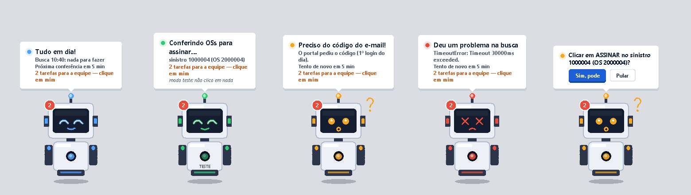
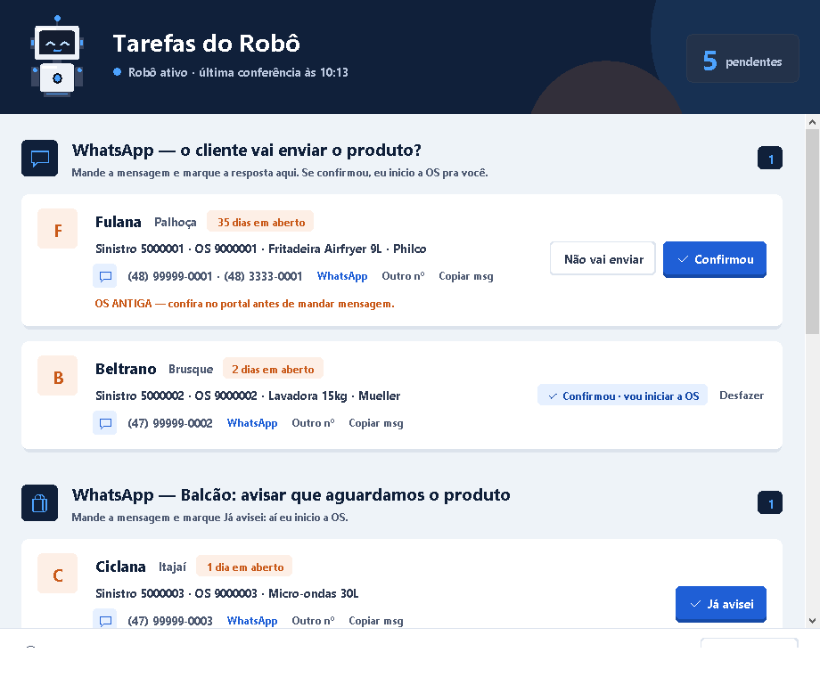
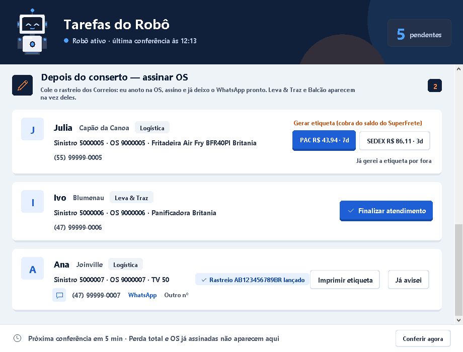
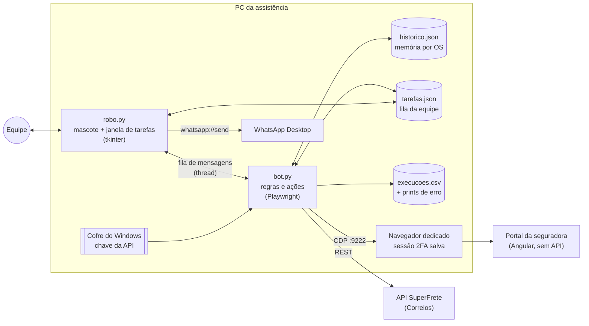
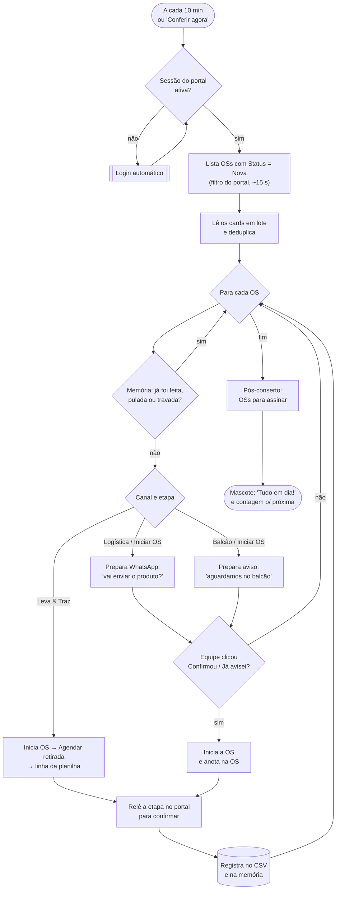
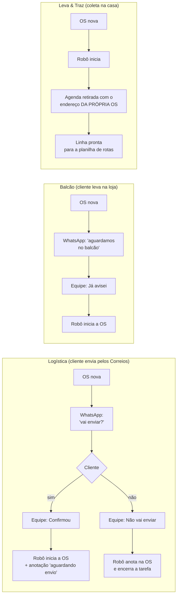
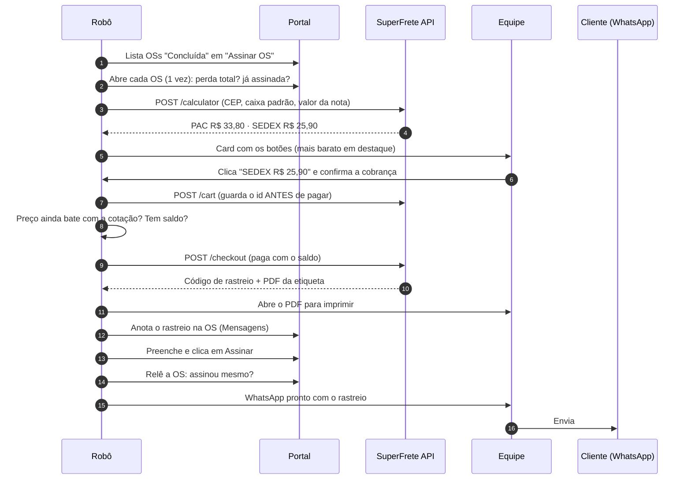
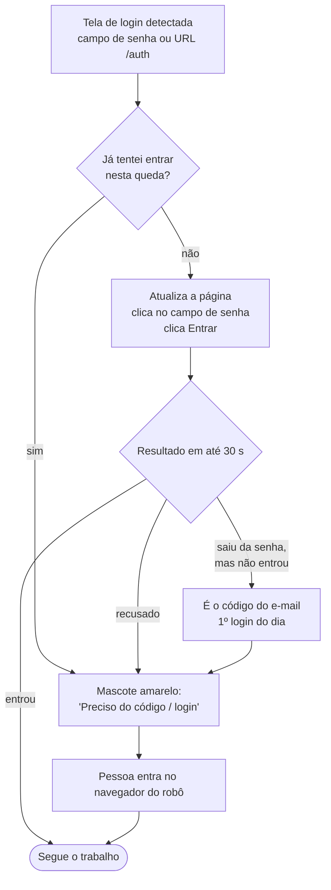
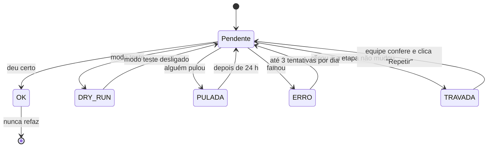

# Robô Prestador — automação do portal de uma seguradora

> Robô em Python que opera, sozinho e com segurança, o portal web de prestadores de uma
> seguradora de garantia estendida. Ele cuida da parte mecânica do dia a dia de uma
> assistência técnica e deixa para a equipe só as decisões.



> Nomes da seguradora e da assistência, números de OS e dados de clientes foram
> **anonimizados**. Os prints usam dados inventados.

---

## O problema

Uma assistência técnica autorizada recebe todas as ordens de serviço (OS) por um **portal
web da seguradora**: uma aplicação Angular **sem API pública** e com **login em dois
fatores**. Cada OS passa por várias etapas, como iniciar, agendar coleta, receber, consertar,
devolver ao cliente e assinar. Em cada uma a equipe:

- abria a OS no portal, preenchia data e responsável e clicava em salvar;
- copiava nome, telefone e endereço do cliente para a planilha e para o WhatsApp;
- gerava a etiqueta dos Correios em outro site e copiava o rastreio de volta para a OS.

Esse trabalho é repetitivo, sujeito a erro de cópia e toma horas por dia.

## A solução

Um robô de desktop que:

1. **Lê o portal** a cada 10 minutos: filtra as OSs novas e as que estão para assinar.
2. **Faz as etapas mecânicas sozinho**: iniciar OS, agendar retirada, anotar mensagens e
   assinar.
3. **Prepara o que depende de gente** numa janela de tarefas: o WhatsApp para o cliente já
   escrito, a linha pronta para a planilha e a etiqueta já cotada.
4. **Executa depois de um clique**: o cliente confirmou → inicia a OS; a equipe escolhe
   PAC ou SEDEX → gera e paga a etiqueta, abre o PDF, anota o rastreio na OS, assina e
   prepara o WhatsApp com o rastreio.
5. **Mostra o que está fazendo** com um mascote animado no canto da tela: azul quando está
   tudo em dia, verde trabalhando, amarelo precisando de alguém, vermelho com problema.

| Janela de tarefas | Depois do conserto (etiqueta) |
|---|---|
|  |  |

---

## Arquitetura



- **Por que conectar via CDP num navegador aberto?** O portal exige 2FA. A pessoa faz o login
  uma vez no navegador do robô e a sessão fica salva no perfil dedicado. O robô só se
  conecta a ele, sem guardar senha nem contornar o 2FA.
- **Interface e robô em threads separadas**, conversando por uma fila: o mascote nunca
  trava enquanto o navegador trabalha. O mesmo bot roda em modo terminal (`--uma-vez`,
  `--debug`).
- **Um único `.exe`** (PyInstaller): a equipe dá clique duplo e pronto. Configuração, memória e
  logs ficam ao lado do executável.

---

## O ciclo do robô



### Entrada da OS por canal



---

## Depois do conserto: etiqueta, rastreio e assinatura



- **Leva & Traz:** a assinatura sai quando a equipe clica "Finalizar atendimento", depois
  da visita técnica.
- **Balcão:** a OS fica "aguardando o cliente retirar" até o clique em "Cliente retirou".
- **Perda total e OS já assinada** são reconhecidas na triagem e nunca aparecem como tarefa.

---

## Sessão e login (2FA)



Só **uma tentativa por queda**: o robô nunca insiste, porque o portal poderia bloquear o
usuário. O navegador entrega a senha salva para a página só depois de um gesto real, por
isso o robô clica no campo antes de clicar em Entrar.

---

## Segurança: o robô não pode errar no portal

| Risco | Como foi tratado |
|---|---|
| Mexer em OS cancelada que ainda aparece como "Iniciar OS" | Só age em OS com o status certo e confere **duas vezes**: na lista e dentro da OS |
| Clicar duas vezes (iniciar/assinar em dobro) | **Memória por OS e etapa**. Clique sem efeito confirmado nunca é repetido sozinho; só depois de "Repetir" na tela de conferência |
| Achar que deu certo sem ter dado | Depois de todo clique final, **relê a etapa** no portal (até 20 s, reabrindo a OS se precisar) |
| Portal com dados de outro cliente no formulário (bug real observado) | Sobrescreve sempre com os dados **da própria OS** e confere campo a campo antes de salvar |
| Cobrança da etiqueta | Só com **clique humano**. O id do envio é gravado antes de pagar (nunca paga dois); confere preço e saldo |
| Testar sem estragar nada | **Modo teste** (preenche, nunca clica no botão final), ligado pelo menu do mascote |
| Mensagem de WhatsApp para a pessoa errada | Envio em 1 clique **desligado de propósito**: quando o número não tem WhatsApp, o app cola o texto na conversa aberta |
| Layout do portal mudar | Seletores estáveis (ids/componentes, nunca `_ngcontent`), print em todo erro e script de mapeamento de telas |

**LGPD:** o robô lê do cliente só o necessário, por uma lista branca de campos. CPF e data de
nascimento ficam de fora, com uma exceção documentada: o CPF vai **direto para a API dos
Correios** na declaração de conteúdo e nunca é gravado nem logado. A chave da API fica
no **Gerenciador de Credenciais do Windows**, nunca em arquivo.

### Memória do robô



---

## Engenharia que vale destacar

- **Portal sem API, "lido" como API**: filtro de status em vez de rolar 800+ cards
  (de ~2,5 min para ~15 s), leitura dos cards em lote com um único `evaluate`, espera de
  lista nova marcando os cards antigos (o Angular reaproveita o DOM) e busca pelo nº do
  sinistro, que é como a equipe trabalha.
- **Interface sem dependências**: o mascote, os cartões arredondados, os botões e o ícone
  são desenhados no `Canvas` do tkinter a partir de um mockup de design. O ícone é gerado
  em PNG/ICO **sem Pillow**, com supersampling e `zlib`.
- **Testes sem tocar na produção**: a OS salva em HTML é aberta num Edge headless separado,
  com um "portal falso", para simular o agendamento (inclusive o bug do formulário de outro
  cliente) e os três cenários de login.
- **Integração REST** com a API do SuperFrete: cotação, carrinho, checkout, PDF, cancelamento e
  idempotência no pagamento.

## Stack

Python 3.14 · Playwright (CDP) · tkinter · urllib/REST · ctypes (Credential Manager e Win32) ·
PyInstaller · Mermaid para a documentação.

## Estrutura

| Arquivo | Papel |
|---|---|
| `bot.py` | ciclo, regras por canal e etapa, ações no portal, login, pós-conserto, etiqueta |
| `robo.py` | mascote, balão, janela de tarefas, menu, ponto de entrada do `.exe` |
| `contatos.py` | fila de tarefas da equipe (WhatsApp, planilha, pós-conserto) e mensagens |
| `historico.py` | memória: o que já foi feito em cada OS e se pode fazer de novo |
| `superfrete.py` | cliente da API do SuperFrete + tela para guardar a chave |
| `cofre.py` | segredos no Gerenciador de Credenciais do Windows |
| `recursos/` | gerador do ícone e do `.exe` |
| `manutencao/` | scripts para mapear telas do portal quando o layout muda |

## Como rodar

```bash
pip install -r requirements.txt
cp config.exemplo.json config.json   # e ajuste
python robo.py                        # mascote + robô
python bot.py --uma-vez --debug       # um ciclo no terminal
python recursos/gerar_executavel.py   # gera o .exe
```

O navegador precisa estar aberto com `--remote-debugging-port=9222` e um perfil próprio; o
robô abre sozinho se não estiver.

## Próximos passos

- API oficial do WhatsApp (Cloud API): enviar e ler as respostas, com classificação por IA
  ("sim / não / passa para a pessoa") no lugar do clique em "Confirmou".
- Escrever direto na planilha de rotas (Graph/Sheets) em vez de "copiar linha".
- Transformar o bot num serviço HTTP local e orquestrar os fluxos com n8n.
- Alertas fora da tela (Telegram/WhatsApp da equipe).
